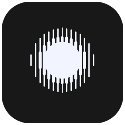

<p align="center">
  <a href="https://brigadier.sh"></a>
</p>

<h1 align="center">Brigadier</h1>

<p align="center">A Mac app where your coding agents work as a team, under your own sign-ins.</p>

<p align="center">
  <a href="https://github.com/syncra-studio/brigadier/actions/workflows/ci.yml"></a>
  <a href="LICENSE"></a>
</p>

<p align="center">
  <a href="https://brigadier.sh">Website</a> ·
  <a href="#install">Install</a> ·
  <a href="#contributing">Contributing</a> ·
  <a href="SECURITY.md">Security</a>
</p>

Brigadier runs the coding agents you already use, Claude Code, Codex and OpenCode, and shows their
work as a chat. You start a **session** for each task. A session can start **workers**: sessions of
their own that take a part of it. In a git project each worker, and each session unless you choose
otherwise, gets a **worktree**: a separate copy of the project's files on its own git branch, so they
don't overwrite each other.

> [!NOTE]
> Brigadier is in active development and has no stable release yet.

## Why Brigadier

- **Work goes on without the app.** Each session runs in a small process of its own, apart from the
  app, so quitting or restarting the app leaves it working.
- **One agent leads, others build.** A session hands parts of its task to workers and gets their
  results; each worker merges its branch with plain git. You can read and message each one.
- **A second agent checks.** A worker's work can go to a review by a different agent, where you have
  one. The worker gets the findings and one turn to fix them: one review, never a loop.
- **The right model for each job.** In Settings › Routing you list which agent, model and effort
  each kind of work gets.
- **Your own agents, unmodified.** Brigadier drives each agent's own command-line tool, signed in by
  you. There is no Brigadier account.

## Features

- **Permission levels.** Ask, Auto or Full access, per session. A project you haven't trusted runs
  at Ask.
- **Review and pull requests.** Read diffs, commit and push, and open, review and merge GitHub pull
  requests beside the chat.
- **Fork and rewind.** Branch a conversation from an earlier answer, even on another agent, or edit
  an earlier message of yours and go on from there.
- **More than one account.** Add several accounts to an agent. When one hits its limit, the session
  can move to the next, if you turn that on.
- **Overnight.** Agree on a list, start the night, and read what was finished, decided and left out
  in the morning.
- **Built-in browser.** Agents read and use web pages in it. Password fields are closed to them.
- **Computer use.** Agents use other Mac apps while your mouse and keyboard stay yours. Password
  fields are closed to them.
- **Plugins.** Set up a skill or MCP server once for every agent. Their keys are kept in one Keychain
  item.

## Install

Ready-made builds come with the first release. Until then, build it from source.

You need:

- a Mac with Apple silicon (Windows and Linux aren't supported yet);
- Apple's command line tools: `xcode-select --install`;
- [rustup](https://rustup.rs), [Node.js](https://nodejs.org) and [pnpm](https://pnpm.io), at the
  versions pinned in `rust-toolchain.toml`, `.node-version` and `package.json`;
- at least one agent from [the list below](#supported-agents); Brigadier's setup can install it;
- `gh`, GitHub's command-line tool, for pull requests and sending feedback.

```sh
git clone https://github.com/syncra-studio/brigadier.git
cd brigadier
pnpm install
pnpm start
```

`pnpm package` makes `out/Brigadier-darwin-arm64/Brigadier.app`, signed ad hoc. Computer use works
only in that build. Brigadier keeps its data in `~/Library/Application Support/Brigadier`; set
`BRIGADIER_DATA` to use another folder.

## Supported agents

| Agent | Models |
| --- | --- |
| [Claude Code](https://code.claude.com/docs) | Claude |
| [Codex](https://developers.openai.com/codex/cli) | OpenAI |
| [OpenCode](https://opencode.ai/docs) | Any provider you give it a key for, and local ones through Ollama, LM Studio or vLLM |

## Contributing

Read [CONTRIBUTING.md](CONTRIBUTING.md) and [ARCHITECTURE.md](ARCHITECTURE.md) first. `pnpm gallery`
shows the app's components, and `pnpm thread` the chat, both on made-up data.

## Community and support

- **Bugs and ideas:** [open an issue](https://github.com/syncra-studio/brigadier/issues/new/choose),
  or use Send Feedback in the app.
- **Security problems:** privately, as [SECURITY.md](SECURITY.md) says.
- **Conduct:** everyone here follows the [Code of Conduct](CODE_OF_CONDUCT.md).

## License

[MIT](LICENSE). Third-party code and icons are listed in
[THIRD_PARTY_NOTICES.md](THIRD_PARTY_NOTICES.md).
